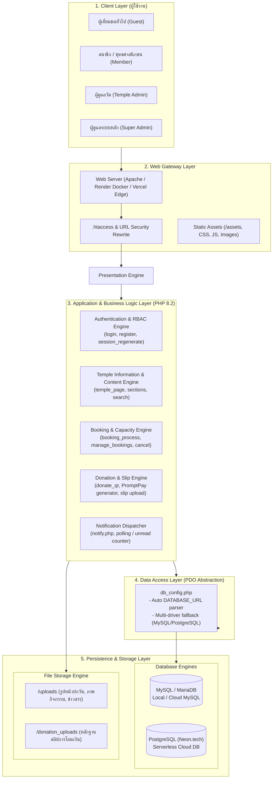
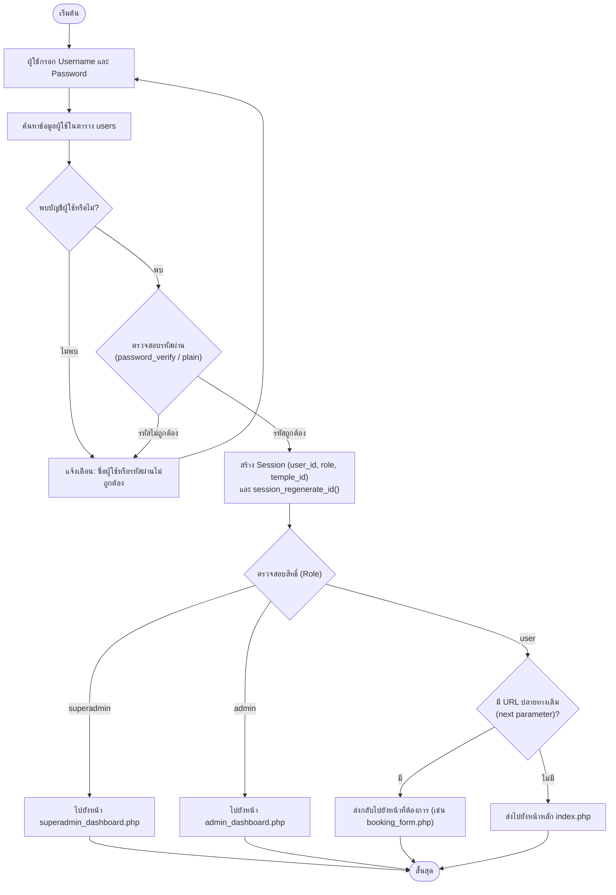
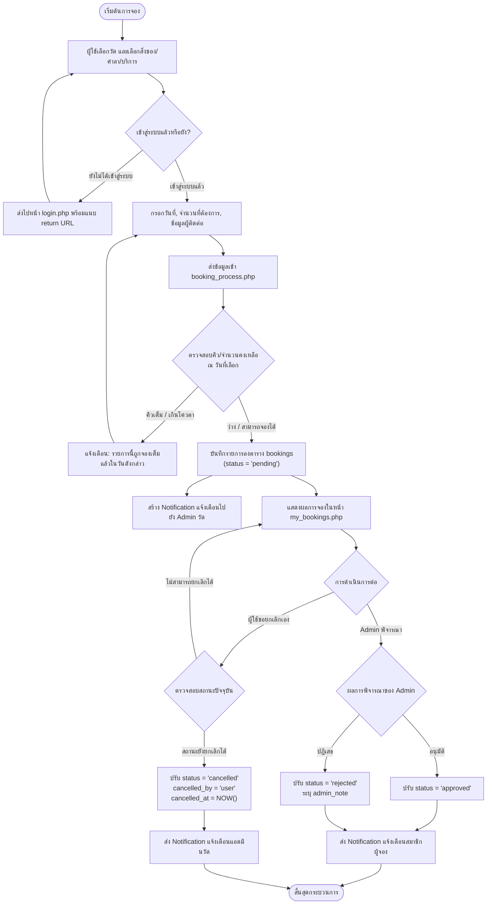
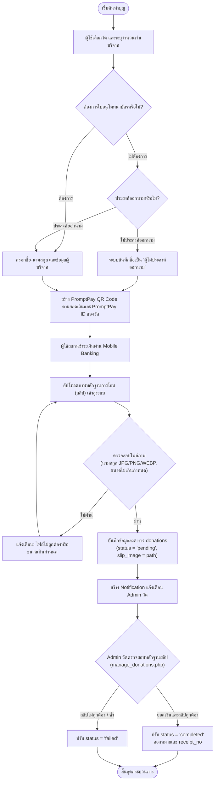
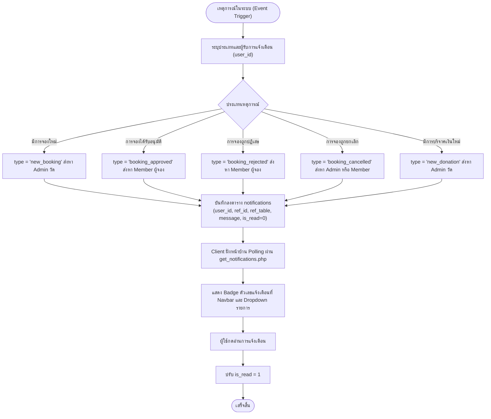
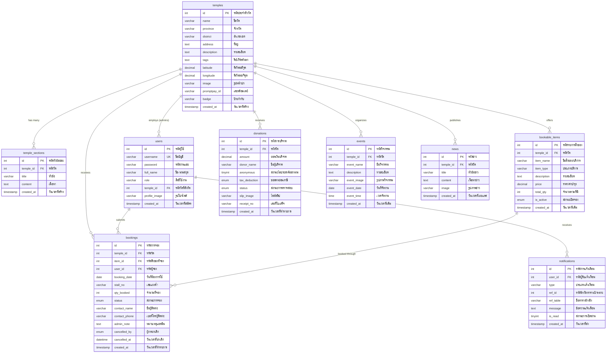

# 🏛️ ThumWadThaiHub — เอกสารโครงสร้างระบบฉบับสมบูรณ์
> **System Architecture, Process Flowcharts, Database Schema & Data Dictionary**  
> *โปรเจกต์: ระบบศูนย์รวมข้อมูลและบริหารจัดการวัดไทยออนไลน์ (ThumWadThaiHub)*

---

## 📋 สารบัญ
1. [System Architecture (สถาปัตยกรรมระบบ)](#1-system-architecture-สถาปัตยกรรมระบบ)
   - [1.1 ภาพรวมสถาปัตยกรรม (High-Level Architecture)](#11-ภาพรวมสถาปัตยกรรม-high-level-architecture)
   - [1.2 โครงสร้างเทคโนโลยี (Technology Stack)](#12-โครงสร้างเทคโนโลยี-technology-stack)
   - [1.3 การควบคุมสิทธิ์การเข้าถึง (Role-Based Access Control)](#13-การควบคุมสิทธิ์การเข้าถึง-role-based-access-control)
2. [Process Flowcharts (แผนผังกระบวนการทำงาน)](#2-process-flowcharts-แผนผังกระบวนการทำงาน)
   - [2.1 การเข้าสู่ระบบและการแยกสิทธิ์ (Authentication & Role Dispatch Flow)](#21-การเข้าสู่ระบบและการแยกสิทธิ์-authentication--role-dispatch-flow)
   - [2.2 วงจรชีวิตการจองสิ่งของและสถานที่ (Booking Lifecycle Flow)](#22-วงจรชีวิตการจองสิ่งของและสถานที่-booking-lifecycle-flow)
   - [2.3 การบริจาคเงินและตรวจสอบสลิป (Online Donation & Slip Verification Flow)](#23-การบริจาคเงินและตรวจสอบสลิป-online-donation--slip-verification-flow)
   - [2.4 ระบบแจ้งเตือน (In-App Notification Dispatch Flow)](#24-ระบบแจ้งเตือน-in-app-notification-dispatch-flow)
3. [Database Schema & ER Diagram (แผนภาพโครงสร้างฐานข้อมูล)](#3-database-schema--er-diagram-แผนภาพโครงสร้างฐานข้อมูล)
   - [3.1 Entity Relationship Diagram (ERD)](#31-entity-relationship-diagram-erd)
   - [3.2 ความสัมพันธ์ระหว่างตาราง (Relationship Summary)](#32-ความสัมพันธ์ระหว่างตาราง-relationship-summary)
4. [Data Dictionary (พจนานุกรมข้อมูลฉบับสมบูรณ์)](#4-data-dictionary-พจนานุกรมข้อมูลฉบับสมบูรณ์)
   - [4.1 ตาราง `temples` (ข้อมูลวัด)](#41-ตาราง-temples-ข้อมูลวัด)
   - [4.2 ตาราง `temple_sections` (ข้อมูลหมวดหมู่ย่อยของวัด)](#42-ตาราง-temple_sections-ข้อมูลหมวดหมู่ย่อยของวัด)
   - [4.3 ตาราง `users` (ผู้ใช้งานและผู้ดูแลระบบ)](#43-ตาราง-users-ผู้ใช้งานและผู้ดูแลระบบ)
   - [4.4 ตาราง `bookable_items` (รายการบริการ/สิ่งของที่เปิดให้จอง)](#44-ตาราง-bookable_items-รายการบริการสิ่งของที่เปิดให้จอง)
   - [4.5 ตาราง `bookings` (ข้อมูลรายการจอง)](#45-ตาราง-bookings-ข้อมูลรายการจอง)
   - [4.6 ตาราง `donations` (ข้อมูลการบริจาคและทำบุญ)](#46-ตาราง-donations-ข้อมูลการบริจาคและทำบุญ)
   - [4.7 ตาราง `events` (กิจกรรมและงานประจำปี)](#47-ตาราง-events-กิจกรรมและงานประจำปี)
   - [4.8 ตาราง `news` (ข่าวสารประชาสัมพันธ์)](#48-ตาราง-news-ข่าวสารประชาสัมพันธ์)
   - [4.9 ตาราง `notifications` (ระบบแจ้งเตือน)](#49-ตาราง-notifications-ระบบแจ้งเตือน)

---

# 1. System Architecture (สถาปัตยกรรมระบบ)

### 1.1 ภาพรวมสถาปัตยกรรม (High-Level Architecture)

ระบบออกแบบตามโครงสร้าง **Multi-Tier Web Architecture** รองรับสภาพแวดล้อมตั้งแต่ Local Server (XAMPP), Dockerized Web Service (Render) จนถึง Serverless (Vercel) เชื่อมโยงกับฐานข้อมูล Dual-Engine (MySQL / Neon PostgreSQL)

### 1.2 โครงสร้างเทคโนโลยี (Technology Stack)
- **Frontend / Client:** HTML5, CSS3, JavaScript (Vanilla JS), Bootstrap / Custom Responsive Styles, FontAwesome Icons
- **Backend / Server:** PHP 8.2 (Procedural + Prepared Statements PDO), Apache HTTP Server (`mod_rewrite`, `mod_headers`)
- **Database Engine:** MySQL 8.x / MariaDB 10.x และ PostgreSQL 15+ (ผ่าน Neon Serverless Driver)
- **File & Media Handling:** PHP GD Library สำหรับตรวจสอบและจัดการไฟล์ภาพอัปโหลด
- **Payment & Verification:** PromptPay QR Code Payload Generator สำหรับบริจาคเงินแบบ Real-time
- **Deployment Platform:** Render (Docker Web Service) และ Vercel (Serverless Functions via `vercel-php`)

### 1.3 การควบคุมสิทธิ์การเข้าถึง (Role-Based Access Control)

| บทบาท (Role) | สิทธิ์การเข้าถึงและการทำงานหลัก | สิทธิ์จัดการข้อมูล | หน้าจอควบคุมหลัก |
| :--- | :--- | :--- | :--- |
| **Guest** | ค้นหาวัดตามภาค/จังหวัด, ดูรายละเอียดวัด, ดูกิจกรรม/ข่าว, สแกน QR บริจาคเงิน | อ่านอย่างเดียว (Read Only) | `index.php`, `temple_page.php`, `donate.php` |
| **Member** (`user`) | จองศาลา/อุปกรณ์/พระสงฆ์/แผงค้า, อัปโหลดสลิปบริจาค, เช็คสถานะ, กดยกเลิกการจอง, รับแจ้งเตือน | บันทึกคำขอและจัดการเฉพาะรายการของตนเอง | `booking.php`, `my_bookings.php`, `check_status.php` |
| **Temple Admin** (`admin`) | บริหารวัดที่สังกัด (`temple_id`), จัดการสิ่งของให้จอง, อนุมัติ/ปฏิเสธการจอง, ตรวจสอบสลิปบริจาค, ลงข่าวและกิจกรรม | จัดการข้อมูลทั้งหมดเฉพาะในวัดของตนเอง | `admin_dashboard.php`, `manage_bookings.php`, `manage_donations.php` |
| **Super Admin** (`superadmin`) | จัดการรายชื่อวัดทั้งหมด, แต่งตั้ง/ลบบัญชีผู้ดูแลวัด, สลับสิทธิ์เข้าดูวัด (`switch_temple`), ดูสถิติรวมทั้งระบบ | สิทธิ์ระดับผู้ดูแลสูงสุด (Full System Access) | `superadmin_dashboard.php`, `manage_temples.php`, `manage_users.php` |

---

# 2. Process Flowcharts (แผนผังกระบวนการทำงาน)

### 2.1 การเข้าสู่ระบบและการแยกสิทธิ์ (Authentication & Role Dispatch Flow)

---

### 2.2 วงจรชีวิตการจองสิ่งของและสถานที่ (Booking Lifecycle Flow)

---

### 2.3 การบริจาคเงินและตรวจสอบสลิป (Online Donation & Slip Verification Flow)

---

### 2.4 ระบบแจ้งเตือน (In-App Notification Dispatch Flow)

---

# 3. Database Schema & ER Diagram (แผนภาพโครงสร้างฐานข้อมูล)

### 3.1 Entity Relationship Diagram (ERD)

### 3.2 ความสัมพันธ์ระหว่างตาราง (Relationship Summary)
- `temples` เป็น Entity ศูนย์กลาง มีความสัมพันธ์แบบ **1 ต่อ หลาย (1:N)** ไปยัง `temple_sections`, `users` (เฉพาะผู้ดูแลวัด), `bookable_items`, `bookings`, `donations`, `events`, และ `news`
- `users` มีความสัมพันธ์แบบ **1 ต่อ หลาย (1:N)** ไปยัง `bookings` (รายการจองของสมาชิก) และ `notifications` (กล่องข้อความแจ้งเตือน)
- `bookable_items` มีความสัมพันธ์แบบ **1 ต่อ หลาย (1:N)** ไปยัง `bookings` (ประวัติการถูกจองของแต่ละสิ่งของ)

---

# 4. Data Dictionary (พจนานุกรมข้อมูลฉบับสมบูรณ์)

### 4.1 ตาราง `temples` (ข้อมูลวัด)
> ตารางจัดเก็บข้อมูลพื้นฐาน ข้อมูลติดต่อ พิกัดภูมิศาสตร์ และหมายเลขพร้อมเพย์ของแต่ละวัด

| ลำดับ | ชื่อฟิลด์ (Field) | ชนิดข้อมูล (Data Type) | Nullable | คีย์ (Key) | ค่าเริ่มต้น (Default) | คำอธิบายความหมาย (Description) |
| :---: | :--- | :--- | :---: | :---: | :---: | :--- |
| 1 | `id` | `INT` | NO | PK | Auto Increment | รหัสประจำตัววัด (Primary Key) |
| 2 | `name` | `VARCHAR(150)` | NO | - | - | ชื่อทางการของวัด |
| 3 | `province` | `VARCHAR(100)` | YES | Index | NULL | จังหวัดที่ตั้งของวัด |
| 4 | `district` | `VARCHAR(100)` | YES | - | NULL | อำเภอ หรือ เขต ที่ตั้ง |
| 5 | `address` | `TEXT` | YES | - | NULL | ที่อยู่ ตำบล ถนน รหัสไปรษณีย์ |
| 6 | `description` | `TEXT` | YES | - | NULL | รายละเอียด ประวัติความเป็นมา ความสำคัญ |
| 7 | `tags` | `TEXT` | YES | - | NULL | คีย์เวิร์ดช่วยค้นหา คั่นด้วย comma (เช่น พระพุทธชินราช, ริมน้ำ) |
| 8 | `latitude` | `DECIMAL(10,8)` | YES | - | NULL | ค่าพิกัดละติจูด (Latitude) สำหรับหมุดแผนที่ |
| 9 | `longitude` | `DECIMAL(11,8)` | YES | - | NULL | ค่าพิกัดลองจิจูด (Longitude) สำหรับหมุดแผนที่ |
| 10 | `image` | `VARCHAR(255)` | YES | - | NULL | ชื่อไฟล์หรือที่อยู่ภาพหน้าปกวัด (`uploads/...`) |
| 11 | `promptpay_id` | `VARCHAR(13)` | YES | - | NULL | เบอร์โทรศัพท์ 10 หลัก หรือเลขบัตรนิติบุคคล 13 หลักสำหรับรับเงิน |
| 12 | `badge` | `VARCHAR(50)` | YES | - | NULL | ป้ายกำกับพิเศษ (เช่น 'วัดอารามหลวง', 'วัดยอดนิยม') |
| 13 | `created_at` | `TIMESTAMP` | YES | - | `CURRENT_TIMESTAMP` | วันและเวลาที่บันทึกข้อมูลวัดเข้าสู่ระบบ |

---

### 4.2 ตาราง `temple_sections` (ข้อมูลหมวดหมู่ย่อยของวัด)
> ตารางเก็บเนื้อหาย่อยและส่วนประกอบเสริมในหน้าวัด เช่น พระประธาน, จุดเช็คอิน, ประวัติเจ้าอาวาส

| ลำดับ | ชื่อฟิลด์ (Field) | ชนิดข้อมูล (Data Type) | Nullable | คีย์ (Key) | ค่าเริ่มต้น (Default) | คำอธิบายความหมาย (Description) |
| :---: | :--- | :--- | :---: | :---: | :---: | :--- |
| 1 | `id` | `INT` | NO | PK | Auto Increment | รหัสประจำตัวหมวดเนื้อหา |
| 2 | `temple_id` | `INT` | NO | FK, Index | - | รหัสวัดที่สังกัด (`temples.id`) |
| 3 | `title` | `VARCHAR(255)` | NO | - | - | ชื่อหัวข้อของหมวดหมู่ |
| 4 | `content` | `TEXT` | NO | - | - | รายละเอียดเนื้อหา |
| 5 | `created_at` | `TIMESTAMP` | YES | - | `CURRENT_TIMESTAMP` | วันและเวลาที่สร้างข้อมูล |

---

### 4.3 ตาราง `users` (ผู้ใช้งานและผู้ดูแลระบบ)
> ตารางจัดการบัญชีผู้ใช้งาน สมาชิกทั่วไป และระดับสิทธิ์ของผู้ดูแลระบบ

| ลำดับ | ชื่อฟิลด์ (Field) | ชนิดข้อมูล (Data Type) | Nullable | คีย์ (Key) | ค่าเริ่มต้น (Default) | คำอธิบายความหมาย (Description) |
| :---: | :--- | :--- | :---: | :---: | :---: | :--- |
| 1 | `id` | `INT` | NO | PK | Auto Increment | รหัสผู้ใช้งาน |
| 2 | `username` | `VARCHAR(50)` | NO | Unique | - | บัญชีผู้ใช้งานสำหรับเข้าสู่ระบบ (ไม่ซ้ำกัน) |
| 3 | `password` | `VARCHAR(255)` | NO | - | - | รหัสผ่านที่ผ่านการเข้ารหัส Bcrypt Hash |
| 4 | `full_name` | `VARCHAR(100)` | NO | - | - | ชื่อ-นามสกุลจริงของผู้ใช้งาน |
| 5 | `role` | `VARCHAR(20)` | NO | - | `'user'` | ระดับสิทธิ์: `'user'`, `'admin'`, `'superadmin'` |
| 6 | `temple_id` | `INT` | YES | FK, Index | NULL | รหัสวัดที่สังกัด (`temples.id`) เฉพาะแอดมินวัด |
| 7 | `profile_image` | `VARCHAR(255)` | YES | - | NULL | ที่อยู่ไฟล์รูปโปรไฟล์ผู้ใช้งาน |
| 8 | `created_at` | `TIMESTAMP` | YES | - | `CURRENT_TIMESTAMP` | วันและเวลาที่สมัครสมาชิก |

---

### 4.4 ตาราง `bookable_items` (รายการบริการ/สิ่งของที่เปิดให้จอง)
> ทรัพยากรของวัดที่เปิดให้สาธุชนหรือญาติโยมทำการจองคิวหรือใช้งาน

| ลำดับ | ชื่อฟิลด์ (Field) | ชนิดข้อมูล (Data Type) | Nullable | คีย์ (Key) | ค่าเริ่มต้น (Default) | คำอธิบายความหมาย (Description) |
| :---: | :--- | :--- | :---: | :---: | :---: | :--- |
| 1 | `id` | `INT` | NO | PK | Auto Increment | รหัสประจำตัวสิ่งของ/บริการ |
| 2 | `temple_id` | `INT` | NO | FK, Index | - | รหัสวัดเจ้าของรายการ (`temples.id`) |
| 3 | `item_name` | `VARCHAR(150)` | NO | - | - | ชื่อของสิ่งของ เช่น ศาลา 1, อุปกรณ์งานศพ, พระสวด |
| 4 | `item_type` | `VARCHAR(50)` | NO | - | - | ประเภท: `pavilion_funeral`, `pavilion_merit`, `monk`, `equipment`, `fair_stall` |
| 5 | `description` | `TEXT` | YES | - | NULL | รายละเอียด อุปกรณ์ที่จัดเตรียมให้ หรือระเบียบการใช้ |
| 6 | `price` | `DECIMAL(10,2)` | NO | - | `0.00` | อัตราค่าบำรุงวัด (บาท) ถ้าไม่มีค่าใช้จ่ายใส่ 0 |
| 7 | `total_qty` | `INT` | NO | - | `1` | จำนวนที่มีให้จองพร้อมกันต่อวัน |
| 8 | `is_active` | `ENUM('yes','no')`| NO | - | `'yes'` | สถานะการเปิดรับจอง (`yes` = เปิด, `no` = ปิดชั่วคราว) |
| 9 | `created_at` | `TIMESTAMP` | YES | - | `CURRENT_TIMESTAMP` | วันและเวลาที่เพิ่มรายการ |

---

### 4.5 ตาราง `bookings` (ข้อมูลรายการจอง)
> ตารางบันทึกการจอง วันที่จอง ข้อมูลติดต่อ และขั้นตอนการอนุมัติ/ยกเลิก

| ลำดับ | ชื่อฟิลด์ (Field) | ชนิดข้อมูล (Data Type) | Nullable | คีย์ (Key) | ค่าเริ่มต้น (Default) | คำอธิบายความหมาย (Description) |
| :---: | :--- | :--- | :---: | :---: | :---: | :--- |
| 1 | `id` | `INT` | NO | PK | Auto Increment | รหัสรายการจอง (Booking ID) |
| 2 | `temple_id` | `INT` | NO | FK, Index | - | รหัสวัดที่ถูกจอง (`temples.id`) |
| 3 | `item_id` | `INT` | NO | FK, Index | - | รหัสสิ่งของ/บริการที่จอง (`bookable_items.id`) |
| 4 | `user_id` | `INT` | YES | FK, Index | NULL | รหัสผู้จองที่เป็นสมาชิก (`users.id`) |
| 5 | `booking_date` | `DATE` | NO | Index | - | วันที่ต้องการใช้งาน/จัดพิธี |
| 6 | `stall_no` | `VARCHAR(20)` | YES | - | NULL | เลขที่แผงค้า (กรณีจองแผงงานวัด `fair_stall`) |
| 7 | `qty_booked` | `INT` | NO | - | `1` | จำนวนที่ขอจอง |
| 8 | `status` | `ENUM(...)` | NO | - | `'pending'` | สถานะ: `'pending'`, `'approved'`, `'confirmed'`, `'success'`, `'rejected'`, `'cancelled'` |
| 9 | `contact_name` | `VARCHAR(100)` | NO | - | - | ชื่อผู้ประสานงาน/เจ้าภาพ |
| 10 | `contact_phone`| `VARCHAR(20)` | NO | - | - | หมายเลขโทรศัพท์ติดต่อผู้ประสานงาน |
| 11 | `admin_note` | `TEXT` | YES | - | NULL | บันทึกข้อความหรือเหตุผลจากแอดมินวัด |
| 12 | `cancelled_by` | `ENUM('user','admin')` | YES | - | NULL | ระบุว่าใครเป็นผู้ขอยกเลิกคำขอ |
| 13 | `cancelled_at` | `DATETIME` | YES | - | NULL | วันและเวลาที่กดยกเลิก |
| 14 | `created_at` | `TIMESTAMP` | YES | - | `CURRENT_TIMESTAMP` | วันและเวลาที่ส่งคำขอจอง |

---

### 4.6 ตาราง `donations` (ข้อมูลการบริจาคและทำบุญ)
> ตารางบันทึกยอดเงินทำบุญออนไลน์ หลักฐานสลิปโอนเงิน และสถานะการออกใบเสร็จ

| ลำดับ | ชื่อฟิลด์ (Field) | ชนิดข้อมูล (Data Type) | Nullable | คีย์ (Key) | ค่าเริ่มต้น (Default) | คำอธิบายความหมาย (Description) |
| :---: | :--- | :--- | :---: | :---: | :---: | :--- |
| 1 | `id` | `INT` | NO | PK | Auto Increment | รหัสรายการบริจาค |
| 2 | `temple_id` | `INT` | YES | FK, Index | NULL | รหัสวัดที่ได้รับบริจาค (`temples.id`) |
| 3 | `amount` | `DECIMAL(12,2)`| NO | - | - | จำนวนเงินทำบุญ (บาท) |
| 4 | `donor_name` | `VARCHAR(100)` | NO | - | `'ผู้ไม่ประสงค์ออกนาม'` | ชื่อผู้ร่วมทำบุญ |
| 5 | `anonymous` | `TINYINT(1)` | NO | - | `0` | สิทธิ์การแสดงชื่อ (`0` = ออกนามหน้าเว็บ, `1` = ปิดชื่อ) |
| 6 | `tax_deduction`| `ENUM('yes','no')`| NO | - | `'no'` | ความต้องการนำไปลดหย่อนภาษี |
| 7 | `status` | `ENUM(...)` | NO | - | `'pending'` | สถานะสลิป: `'pending'`, `'completed'`, `'failed'` |
| 8 | `slip_image` | `VARCHAR(255)` | YES | - | NULL | ที่อยู่ไฟล์สลิป (`donation_uploads/...`) |
| 9 | `receipt_no` | `VARCHAR(50)` | YES | - | NULL | เลขที่ใบเสร็จหรือหมายเลขอ้างอิงใบอนุโมทนา |
| 10 | `created_at` | `TIMESTAMP` | YES | Index | `CURRENT_TIMESTAMP` | วันและเวลาที่ทำรายการบริจาค |

---

### 4.7 ตาราง `events` (กิจกรรมและงานประจำปี)
> กิจกรรมงานบุญ เทศกาลวันสำคัญทางศาสนาที่จัดขึ้นโดยวัด

| ลำดับ | ชื่อฟิลด์ (Field) | ชนิดข้อมูล (Data Type) | Nullable | คีย์ (Key) | ค่าเริ่มต้น (Default) | คำอธิบายความหมาย (Description) |
| :---: | :--- | :--- | :---: | :---: | :---: | :--- |
| 1 | `id` | `INT` | NO | PK | Auto Increment | รหัสประจำตัวกิจกรรม |
| 2 | `temple_id` | `INT` | NO | FK, Index | - | รหัสวัดผู้จัดงาน (`temples.id`) |
| 3 | `event_name` | `VARCHAR(200)` | NO | - | - | ชื่องานบุญหรือกิจกรรม |
| 4 | `description` | `TEXT` | YES | - | NULL | กำหนดการและรายละเอียดงาน |
| 5 | `event_image` | `VARCHAR(255)` | YES | - | NULL | ไฟล์รูปภาพประชาสัมพันธ์งาน |
| 6 | `event_date` | `DATE` | NO | Index | - | วันที่จัดกิจกรรม |
| 7 | `event_time` | `TIME` | YES | - | NULL | เวลาเริ่มต้นกิจกรรม |
| 8 | `created_at` | `TIMESTAMP` | YES | - | `CURRENT_TIMESTAMP` | วันและเวลาที่เพิ่มกิจกรรม |

---

### 4.8 ตาราง `news` (ข่าวสารประชาสัมพันธ์)
> ข่าวสาร การพัฒนาวัด และประกาศทางการจากทางวัด

| ลำดับ | ชื่อฟิลด์ (Field) | ชนิดข้อมูล (Data Type) | Nullable | คีย์ (Key) | ค่าเริ่มต้น (Default) | คำอธิบายความหมาย (Description) |
| :---: | :--- | :--- | :---: | :---: | :---: | :--- |
| 1 | `id` | `INT` | NO | PK | Auto Increment | รหัสประจำตัวข่าวสาร |
| 2 | `temple_id` | `INT` | NO | FK, Index | - | รหัสวัดผู้เผยแพร่ข่าว (`temples.id`) |
| 3 | `title` | `VARCHAR(255)` | NO | - | - | หัวข้อข่าว |
| 4 | `content` | `TEXT` | NO | - | - | เนื้อหาข่าวโดยละเอียด |
| 5 | `image` | `VARCHAR(255)` | YES | - | NULL | รูปภาพประกอบข่าว |
| 6 | `created_at` | `TIMESTAMP` | YES | - | `CURRENT_TIMESTAMP` | วันและเวลาที่เผยแพร่ข่าว |

---

### 4.9 ตาราง `notifications` (ระบบแจ้งเตือน)
> การแจ้งเตือนความคืบหน้าของคำขอจอง การบริจาคเงิน และข่าวสารไปยังสมาชิกหรือแอดมิน

| ลำดับ | ชื่อฟิลด์ (Field) | ชนิดข้อมูล (Data Type) | Nullable | คีย์ (Key) | ค่าเริ่มต้น (Default) | คำอธิบายความหมาย (Description) |
| :---: | :--- | :--- | :---: | :---: | :---: | :--- |
| 1 | `id` | `INT` | NO | PK | Auto Increment | รหัสการแจ้งเตือน |
| 2 | `user_id` | `INT` | NO | FK, Index | - | รหัสผู้ใช้ที่จะได้รับการแจ้งเตือน (`users.id`) |
| 3 | `type` | `VARCHAR(50)` | NO | - | - | ประเภทแจ้งเตือน: `new_booking`, `booking_approved`, `booking_rejected`, `booking_cancelled`, `new_donation`, `new_member` |
| 4 | `ref_id` | `INT` | YES | - | NULL | รหัสอ้างอิงข้อมูล เช่น booking_id หรือ donation_id |
| 5 | `ref_table` | `VARCHAR(50)` | YES | - | NULL | ชื่อตารางอ้างอิง เช่น `'bookings'`, `'donations'` |
| 6 | `message` | `TEXT` | NO | - | - | ข้อความแจ้งเตือนที่แสดงบนหน้าจอ |
| 7 | `is_read` | `TINYINT(1)` | NO | Index | `0` | สถานะการอ่าน (`0` = ยังไม่อ่าน, `1` = อ่านแล้ว) |
| 8 | `created_at` | `TIMESTAMP` | YES | Index | `CURRENT_TIMESTAMP` | วันและเวลาที่สร้างการแจ้งเตือน |

---
*เอกสารนี้สร้างขึ้นโดยอ้างอิงโครงสร้างฐานข้อมูลและระบบการทำงานจริงของ ThumWadThaiHub ณ วันที่ 3 พฤศจิกายน 2026*
